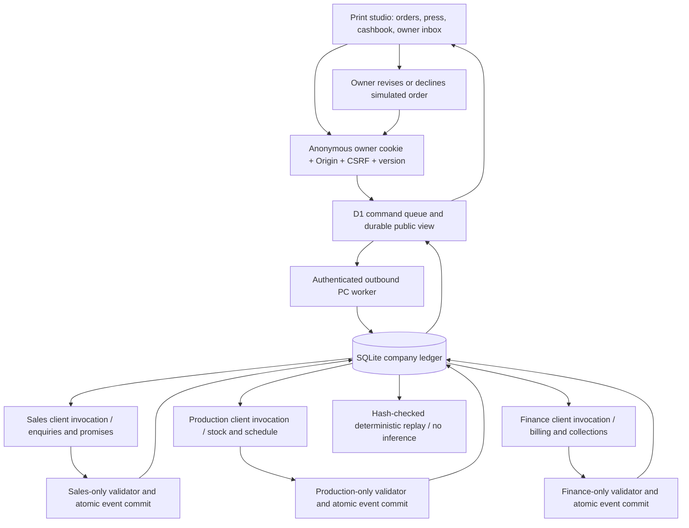

# One company record, three accountable roles

`src/roles.js` defines independent mandates, record views and output schemas. Every role makes its own real supported-client call from a separate role workspace. The shared model does not impersonate the entire team in a single response. `src/company.js` schedules the roles in Sales → Production → Finance order so each sees preceding committed work. This is dependency ordering, not a predetermined business-action script: the model may wait, choose another allowed action, or fail.

`src/domain.js` computes business invariants and atomic changes. It contains no scenario-specific automatic express-purchase action. Production must infer and propose that correction. Invoice values come from actual completed order records; collections come from unpaid invoices. Owner authority is a separate endpoint and event, never a model-supplied approval bit.

`src/ledger.js` commits state and its event under one SQLite transaction. Events have monotonically increasing sequence numbers and previous-event hashes. The job table stores completed results to prevent reinference and duplicate financial actions on retry. A day is a sequence of atomic role actions, not one transaction: a later role failing preserves earlier valid work. Recovery is compensating work on current records, not rollback of already completed orders.

`src/hosted.js` is shared by the actual Worker route and the local HTTP relay. Local transport tests execute its SQL through Node SQLite; production uses Cloudflare D1. D1 serializes job admission and limits, claims a job once, and refuses expired or duplicate completion. Progress snapshots carry monotonic revisions, so an older poll cannot overwrite a newer view, even after a new week resets the event sequence.

The outbound worker authenticates to one approved Site origin. The provider key stays in the existing private PC environment; a distinct service token is a native Site secret. Visitors cannot claim work, post arbitrary company snapshots or select a different model/provider. Anonymous company cookies isolate records, but do not promise cross-device identity or availability while the PC sleeps.

Replay is deterministic record projection, explicitly labeled in the UI. It does not reenact an AI conversation, call a model, charge the allowance, print again, or collect again. The JSON daybook contains the actual simulator records and decisions, making every KPI explainable by its underlying events.
