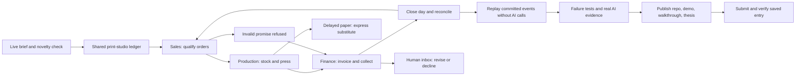

# Daymark methodology map

Mission: The Autonomous Company Simulator. Live brief inspected October 19, 2026.

The three agents have separate invocations, prompts, record views and operation allowlists. Each reads the actual committed changes of preceding roles. A single all-role prompt is not used. Their shared state is an event-sourced company persisted in SQLite on the operator's PC, with an authenticated D1 job relay and durable public view. Replay reconstructs records from committed actions and verifies the hash chain; it never asks a model to reenact history.

Daymark is an independent print studio. All customers, money and orders are explicitly simulated; transactions genuinely change the prototype's records. It does not send quotes, buy paper, charge cards or impersonate a real company. The model selects business actions; code enforces authority, stock, cash reserve, capacity, margin, invoicing and exactly-once payment.

Novelty: unlike the authority, delegation, adaptation, memory, SQL-preview and editorial entries, this is an end-to-end company operating loop. The interface is a working print floor: tickets, a press rail, paper shelves, a cashbook and an owner inbox.

Gates: domain and ledger → independent role calls → self-correction → human exception → replay and role failure → clean source/security/browser verification → public release → continuous walkthrough → saved-entry confirmation. Each gate requires actual evidence; no fixtures are presented as live model output.
